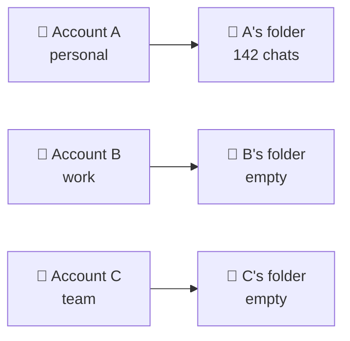
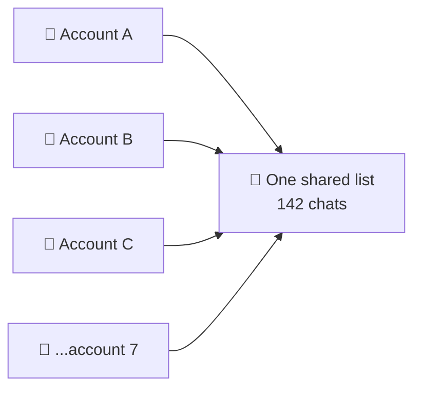
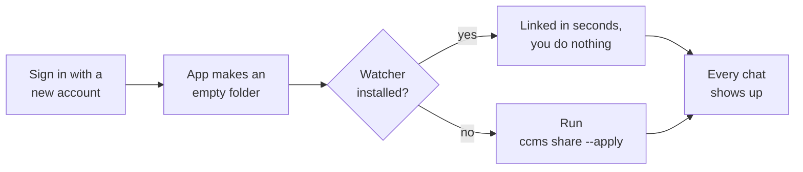

# CCMS — Claude Code Multi-Session

```
 ██████╗ ██████╗███╗   ███╗███████╗
██╔════╝██╔════╝████╗ ████║██╔════╝
██║     ██║     ██╔████╔██║███████╗
██║     ██║     ██║╚██╔╝██║╚════██║
╚██████╗╚██████╗██║ ╚═╝ ██║███████║
 ╚═════╝ ╚═════╝╚═╝     ╚═╝╚══════╝
```

**Share your Claude Code sessions across every Claude account on one Mac.**

Many accounts, one machine — personal, work, Team, old plan, new plan. It does
*not* copy sessions between computers.

## The problem

Your chats are stored per account, so each account sees only its own:



Sign in with another account and the sidebar looks wiped. Nothing was deleted.
Same thing when a plan expires or you join a Team.

## What CCMS does

Puts the chats in one place and points every account at it:



Any number of accounts. Start a chat on A, switch to B, open it and keep
typing — same session, full scrollback. New chats appear everywhere at once.

## Setup

**1. Download it.**

```bash
curl -fsSLO https://raw.githubusercontent.com/iam-joey/ccms/main/ccms.sh
chmod +x ccms.sh
./ccms.sh check
```

**2. Quit the Claude app — properly.** `Cmd+Q`, not just closing the window.
It will not move your chats while the app is running. (Or add `--force` to the
next command and skip this.)

**3. Share them.**

```bash
./ccms.sh share --apply
```

Reopen Claude. Every account now shows the same chats.

Optional — to type `ccms` instead of `./ccms.sh` from anywhere:

```bash
sudo install -m 755 ccms.sh /usr/local/bin/ccms
```

## Commands

| Command | What it does |
| --- | --- |
| `ccms check` | checks the Claude app is installed and its files are where we expect |
| `ccms scan` | lists your accounts and how many chats each one sees |
| `ccms share` | shows what would change, changes nothing |
| `ccms share --apply` | does it — every account now shares one list |
| `ccms status` | checks everything is still linked |
| `ccms revert --apply` | undoes it — every chat back where it came from |
| `ccms watch --install` | keeps new accounts shared automatically |

`--force` runs even while Claude is open. `ccms --help` for the rest.

## New accounts

Sign in with a new account, or join a Team, and the app makes a new empty
folder for it:



The watcher sleeps until a folder changes — no cron, no polling, nothing
running in the background.

## Notes

- **Undo:** `share --apply` records everything it moved and backs up every
  folder it replaced, in `~/.ccms`. `ccms revert --apply` puts it all back.
- macOS and the Claude **desktop app** only. The `claude` CLI keeps its
  transcripts elsewhere and already shares them across accounts.
- Every account sees every chat. You can't share with some and not others.
- CCMS shares what is on your Mac. Anything kept on Anthropic's servers stays
  with the account that made it — connectors, and published artifacts (the
  link travels with the chat, but opening it depends on your claude.ai access).
- Sidebar groups are saved per account, so the folders you sort chats into
  don't carry over. The chats do.
- One Mac only. The chat itself lives in `~/.claude/projects`, in folders
  named after the path you ran it from, username included — so copying
  sessions to another computer is a different job.

## Licence

MIT. See [LICENSE](LICENSE).
