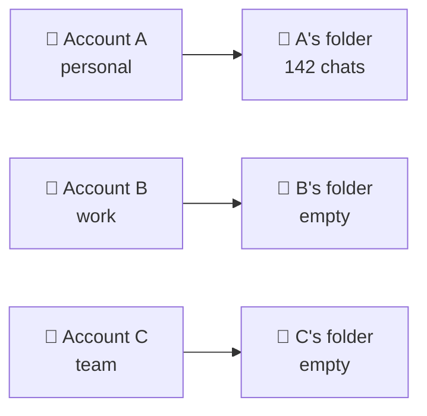
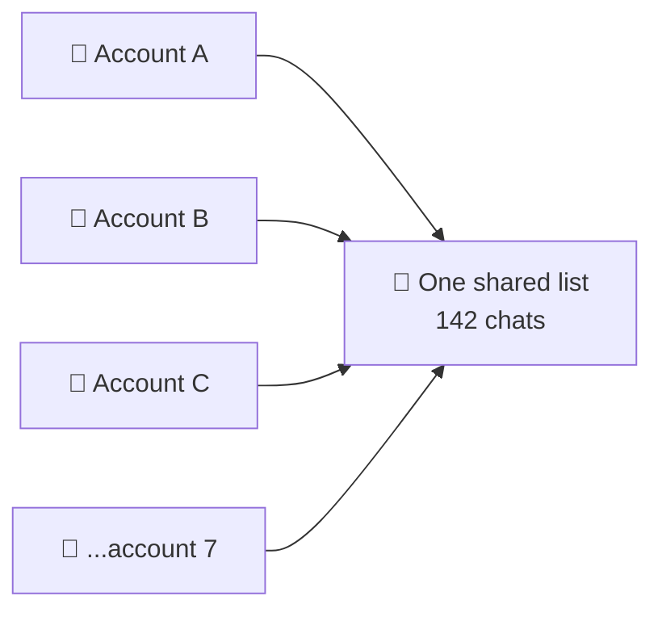
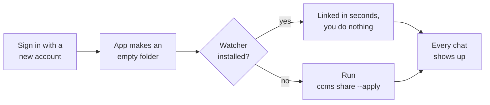

# CCMS — Claude Code Multi-Session

```
 ██████╗ ██████╗███╗   ███╗███████╗
██╔════╝██╔════╝████╗ ████║██╔════╝
██║     ██║     ██╔████╔██║███████╗
██║     ██║     ██║╚██╔╝██║╚════██║
╚██████╗╚██████╗██║ ╚═╝ ██║███████║
 ╚═════╝ ╚═════╝╚═╝     ╚═╝╚══════╝
```

One Claude Code sidebar for every Claude account on your Mac.

## The problem

Say you have two accounts, **A** (personal) and **B** (work).

| You are signed in as | Your sidebar shows |
| --- | --- |
| A | A's chats |
| B | nothing |
| A again | A's chats, all back |

Nothing was deleted. The Claude app keeps a **separate folder of chats for each
account**, and only ever shows you the one you are signed into:



Same thing happens when a plan expires, when you join a Team, or when you add
another account.

## What CCMS does

It puts the chats in one folder and points **every** account at it:



| You are signed in as | Your sidebar shows |
| --- | --- |
| A | every chat |
| B | every chat |
| a brand new account C | every chat |

Start a chat while on B, switch to A — it's there. It works both ways.

**Any number of accounts.** Two, five, ten — they all point at the same list,
and each new one joins it. There is no limit and nothing to configure per
account.

One bash script. Nothing to install.

## Install

**Step 1 — download the script and check your Mac.** Run these three lines
together, in whatever folder you like:

```bash
curl -fsSLO https://raw.githubusercontent.com/iam-joey/ccms/main/ccms.sh
chmod +x ccms.sh
./ccms.sh check
```

That is the whole install. You run it as `./ccms.sh <command>` from that
folder — `./ccms.sh share`, `./ccms.sh status`, and so on.

**Step 2 — optional.** If you would rather type `ccms` from anywhere instead
of `./ccms.sh`, move the file you just downloaded onto your PATH:

```bash
sudo install -m 755 ccms.sh /usr/local/bin/ccms
```

It asks for your Mac password, because `/usr/local/bin` is a system folder.
Skip this and everything still works — just keep the `./ccms.sh` prefix.

## Commands

Written as `ccms` below. If you skipped step 2, type `./ccms.sh` instead.

| Command | What it does |
| --- | --- |
| `ccms check` | checks the Claude app is installed and its files are where we expect |
| `ccms scan` | lists your accounts and how many chats each one sees |
| `ccms share` | shows what would change, changes nothing |
| `ccms share --apply` | does it — every account now shares one list |
| `ccms status` | checks everything is still linked |
| `ccms revert --apply` | undoes it — every chat back where it came from |
| `ccms watch --install` | keeps new accounts shared automatically |
| `ccms watch --uninstall` | removes that |

Quit the Claude app before `--apply`. Add `--force` to do it anyway.

## New accounts

Sign in with a new account, or join a Team, and the app makes a new empty
folder for it. Run `ccms share --apply` once and it joins the shared list.

`ccms watch --install` does that for you from then on. It sleeps until a folder
changes — no cron, no polling, nothing running in the background.



## Undo

`ccms share --apply` writes down everything it moved, and keeps a backup of
every folder it replaced, in `~/.ccms`. `ccms revert --apply` puts it all back.

## Notes

- macOS, and the Claude **desktop app** only. The `claude` CLI stores its
  transcripts elsewhere and already shares them across accounts.
- Every account sees every chat. You cannot share with some accounts and not
  others.
- Connectors are not touched. They stay with the account you added them to.

## Options

| | |
| --- | --- |
| `--force` | run even while the Claude app is open |
| `--no-banner` | skip the logo |
| `--no-watch` | don't ask about the watcher |
| `NO_COLOR=1` | no colours |
| `CCMS_SUPPORT` | where the Claude app keeps its files |
| `CCMS_HOME` | where CCMS keeps its backups (default `~/.ccms`) |

## Licence

MIT. See [LICENSE](LICENSE).
