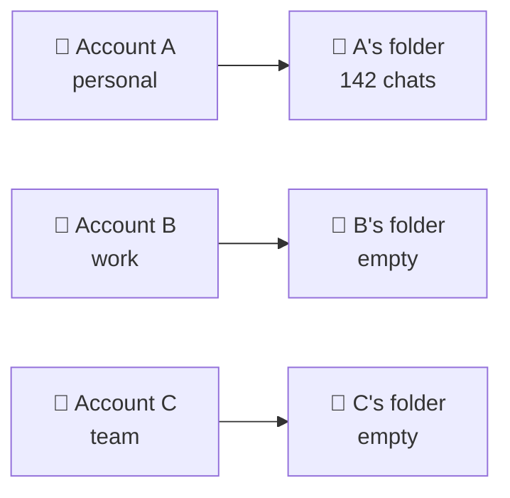
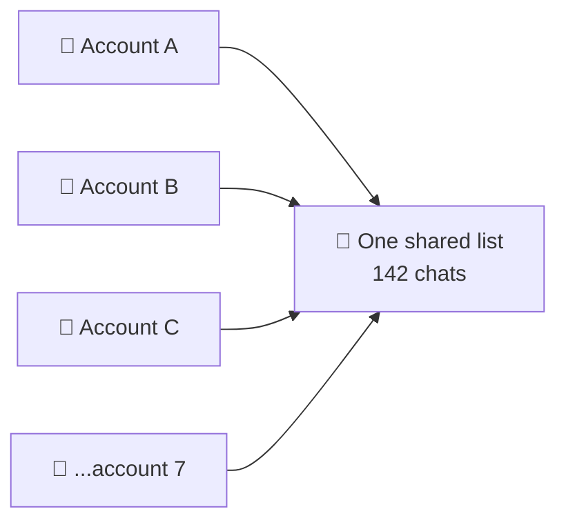
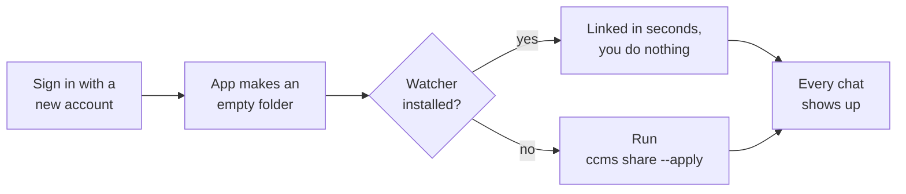

# CCMS — Claude Code Multi-Session

```
 ██████╗ ██████╗███╗   ███╗███████╗
██╔════╝██╔════╝████╗ ████║██╔════╝
██║     ██║     ██╔████╔██║███████╗
██║     ██║     ██║╚██╔╝██║╚════██║
╚██████╗╚██████╗██║ ╚═╝ ██║███████║
 ╚═════╝ ╚═════╝╚═╝     ╚═╝╚══════╝
```

**Share your Claude Code sessions across every Claude account on your Mac.**

For the Claude desktop app on macOS. One bash script, nothing to install.

## The problem

Your chats are stored per account, so each account sees only its own:



Sign in with another account and the sidebar looks wiped. Nothing was deleted.
Same thing when a plan expires or you join a Team.

## What CCMS does

Puts the chats in one place and points every account at it:



Any number of accounts. Nothing to configure per account.

**It works both ways.** Start a chat on A, switch to B, open it and keep
typing — same session, full scrollback. A chat started on B is already on A.
Renaming and archiving carry over too.

## Install

```bash
curl -fsSLO https://raw.githubusercontent.com/iam-joey/ccms/main/ccms.sh
chmod +x ccms.sh
./ccms.sh check
```

That's the whole install — run it as `./ccms.sh <command>`.

Optional: to type `ccms` from anywhere instead, move the file you just
downloaded onto your PATH.

```bash
sudo install -m 755 ccms.sh /usr/local/bin/ccms
```

## Commands

| Command | What it does |
| --- | --- |
| `ccms check` | checks the Claude app is installed and its files are where we expect |
| `ccms scan` | lists your accounts and how many chats each one sees |
| `ccms share` | shows what would change, changes nothing |
| `ccms share --apply` | does it — every account now shares one list |
| `ccms status` | checks everything is still linked |
| `ccms revert --apply` | undoes it — every chat back where it came from |
| `ccms watch --install` | keeps new accounts shared automatically |

Quit the Claude app before `--apply`, or add `--force`. Run `ccms --help` for
the rest.

## New accounts

Sign in with a new account, or join a Team, and the app makes a new empty
folder for it:



The watcher sleeps until a folder changes — no cron, no polling, nothing
running in the background.

## Undo

`ccms share --apply` writes down everything it moved and backs up every folder
it replaced, in `~/.ccms`. `ccms revert --apply` puts it all back.

## Notes

- macOS, and the Claude **desktop app** only. The `claude` CLI keeps its
  transcripts elsewhere and already shares them across accounts.
- Every account sees every chat. You can't share with some accounts and not
  others.
- Connectors stay with the account you added them to.
- Sidebar groups are saved per account, so the folders you sort chats into
  don't carry over. The chats do.

## Licence

MIT. See [LICENSE](LICENSE).
